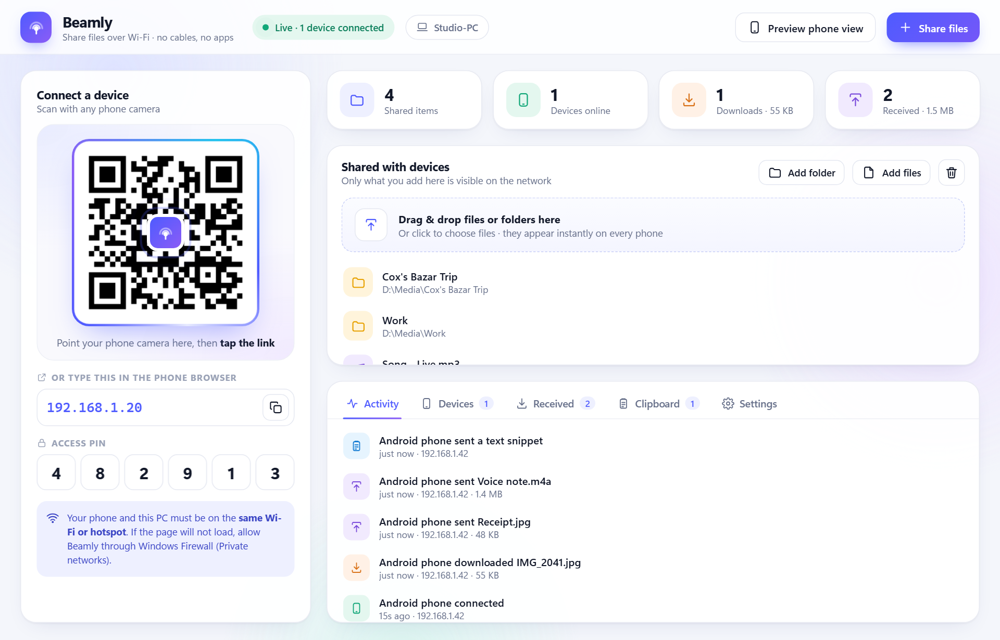
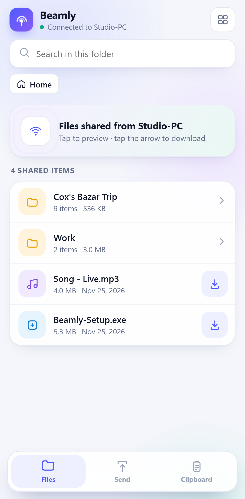
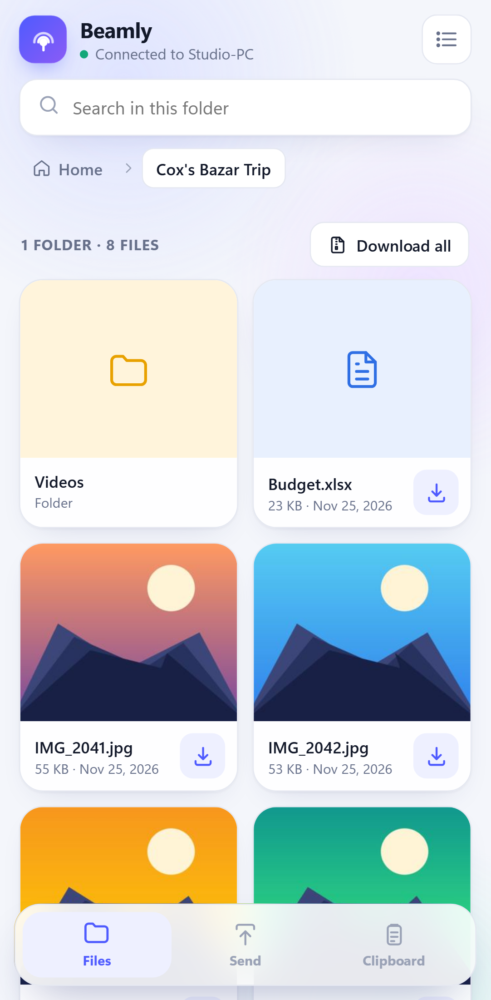
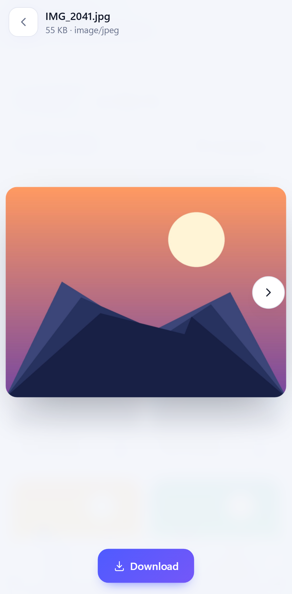
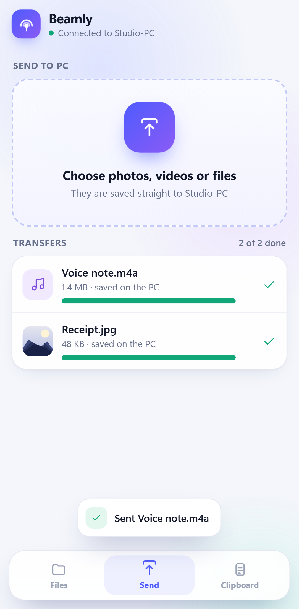

<p align="center">
  
</p>

<h1 align="center">Beamly</h1>

<p align="center">
  <b>Beam files from your Windows PC to any phone on the same Wi-Fi.</b><br>
  Scan a QR code → browse, preview and download. No app on the phone, no cables, no cloud.
</p>

<p align="center">
  
  
  
  
  
</p>

<p align="center">
  
</p>

<p align="center">
  
  
  
  
</p>

---

## Why Beamly?

Moving a file from a PC to a phone is still a hassle: cables, chat apps that shrink your photos,
cloud uploads for something that is sitting one metre away. Beamly turns your PC into a small,
private file server on your own Wi-Fi. Pick what to share, scan the QR code, done.
Everything stays on your local network.

## Features

**On the PC (desktop app)**
- Big QR code with a short address such as `192.168.1.20` and a 6-digit PIN
- Share files or whole folders with buttons or **drag & drop from Explorer**
- Live dashboard: devices online, downloads, received files, activity feed
- Pop-up notifications when a phone connects, sends a file or sends a text
- **Received** tab: open, or show in folder, the files phones sent you
- Shared clipboard: send links, OTPs and notes to your phone
- Settings: allow or block uploads, require a PIN, new PIN, receive folder

**On the phone (any browser: Android, iPhone, tablet or another laptop)**
- Browse folders, search, list or grid view with photo thumbnails
- Full-screen preview of photos, video, audio, PDF and text, with swipe between files
- Download single files, or **a whole folder as one ZIP** (streamed, no temp files)
- **Send to PC**: upload photos and files with per-file progress and speed
- Shared clipboard with clickable links and one-tap copy

**Security and reliability**
- Only the items you add are visible. Nothing else on the PC can be reached.
- Access needs the PIN; the QR code carries it, so scanning logs in automatically.
  Wrong PINs are rate-limited, and a new PIN locks out every old device.
- Path traversal is blocked, and the desktop control API only answers on `127.0.0.1`
- Single instance: opening Beamly twice brings the existing window to the front
- Crash log at `%APPDATA%\Beamly\beamly.log`

## Quick start

Requirements: **Windows 10/11** with **Python 3.10+**. The Microsoft Edge WebView2 runtime ships with Windows 11.

```bat
git clone https://github.com/SharpWizard/beamly.git
cd beamly
START.bat
```

`START.bat` installs the requirements the first time and opens the app. Or run it yourself:

```bash
pip install -r requirements.txt
python app.py              # desktop window
python app.py --server     # headless: prints the link and keeps serving
```

> **First run:** Windows Firewall asks whether Python may use the network.
> Tick **Private networks** and allow it, or phones will not be able to reach your PC.

### Connecting a phone
1. Make sure the phone is on the **same Wi-Fi or hotspot** as the PC.
2. Point the phone camera at the QR code and tap the link.
   Or type the address shown, for example `192.168.1.20`, into the phone browser and enter the PIN.
3. Browse, preview and download. Use the **Send** tab to push files back to the PC.

## How it works

```
 ┌──────────────── Windows PC ────────────────┐            ┌──── Phone ────┐
 │  pywebview window  ──►  /desk  (127.0.0.1)  │            │   browser     │
 │                                             │   Wi-Fi    │               │
 │  Flask app served by waitress on 0.0.0.0 ◄──┼────────────┼── /  /api/*   │
 │   • shares only the paths you added         │            │   /f /z /t    │
 │   • PIN cookie, rate-limited unlock         │            └───────────────┘
 └─────────────────────────────────────────────┘
```

- **Port:** Beamly binds port 80 when it is free, so the address needs no `:port`.
  It falls back to 8080, 8000 or 8765. The socket is bound with `SO_EXCLUSIVEADDRUSE`,
  so no other program can share it.
- **QR link:** `http://<pc-ip>/<pin>` sets a 30-day cookie and redirects to the file browser.
- **Downloads** use HTTP range requests, so videos can be seeked and large files resumed.
  Folder ZIPs are streamed as they are built.
- **Settings** live in `%APPDATA%\Beamly\config.json`. Received files go to `Downloads\Beamly` by default.

## Project layout

```
app.py                 Flask server, file APIs, desktop window (pywebview)
templates/desktop.html PC dashboard
templates/share.html   Phone file browser / send / clipboard
templates/unlock.html  PIN screen
static/                icons.js (icons + motion helpers), ui.css, logo and app icon
tools/make_icon.py     Renders static/beamly.ico and beamly.png
tools/screenshots.py   Renders the README screenshots with demo data
tests/e2e.py           End-to-end browser test of phone + desktop (Playwright)
START.bat              One-click launcher
```

## Testing

```bash
pip install playwright && python -m playwright install chromium
python tests/e2e.py
```

The test starts its own server with a throwaway config and drives a phone (Pixel 7 emulation)
and the desktop page through 50 checks: PIN lock, browsing, search, grid view, preview,
downloads, ZIP, uploads, clipboard both ways, settings, unsharing and PIN rotation.
It never touches your real settings.

## FAQ

**The phone cannot open the page.**
Check that both devices are on the same network. Some guest Wi-Fi networks block devices from
seeing each other. Allow Python in Windows Firewall for *Private* networks, and make sure your
Wi-Fi is set to *Private* rather than *Public* in Windows settings.

**The address shows a port, like `:8080`.**
Another program, such as Apache, IIS or Skype, already uses port 80. Beamly picked the next free port.

**Is anything uploaded to the internet?**
No. Beamly has no cloud component. Files go directly between your devices over your local network.

## License

[MIT](LICENSE) © SharpWizard
